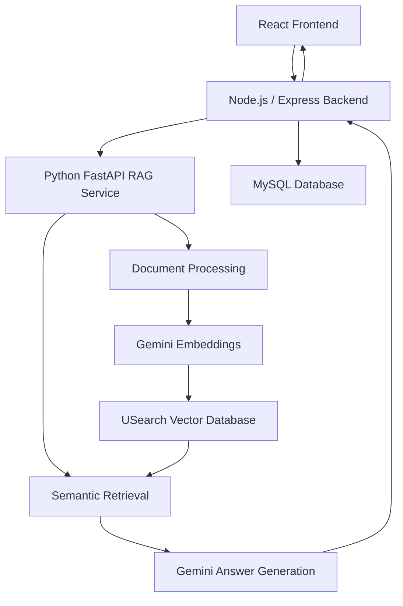

# Conversational RAG System – AI Knowledge Assistant

An AI-powered knowledge assistant that allows users to upload documents and ask questions using natural language. It retrieves relevant information from uploaded documents and generates context-aware answers using Google's Gemini models.

## Features

- Upload PDF, DOCX and TXT documents.
- Extract and split document content into smaller chunks.
- Generate document embeddings using Google Gemini.
- Store and search embeddings using USearch vector database.
- Retrieve relevant document content using semantic search.
- Generate answers using Gemini based on retrieved context.
- Display answers with Markdown formatting and source documents.
- Store document metadata and conversation history in MySQL.
- React-based chat interface.

## Architecture



## Technology Stack

| Layer | Technologies |
|---|---|
| Frontend | React, Vite, Tailwind CSS, Axios |
| Backend | Node.js, Express.js |
| AI Service | Python, FastAPI |
| Embeddings | Google Gemini |
| LLM | Google Gemini |
| Vector Database | USearch |
| Database | MySQL |
| Document Processing | PyMuPDF, python-docx |
| Version Control | Git, GitHub |

## Project Structure

```text
Conversational RAG/
├── frontend/
│   └── src/
│       ├── components/
│       ├── services/
│       ├── App.jsx
│       └── main.jsx
├── backend/
│   ├── src/
│   │   ├── config/
│   │   ├── controllers/
│   │   ├── middleware/
│   │   ├── routes/
│   │   ├── services/
│   │   └── server.js
│   └── .env.example
├── ai-service/
│   ├── rag/
│   ├── tests/
│   ├── storage/
│   ├── main.py
│   ├── requirements.txt
│   └── .env.example
├── database/
├── .gitignore
└── README.md
```

## Prerequisites

Install the following before running the project:

- Python 3.15
- Node.js and npm
- MySQL Server 8.4 or later
- Git
- Google Gemini API key

## Setup Instructions

### 1. Clone the repository

```bash
git clone YOUR_GITHUB_REPOSITORY_URL
cd "Conversational RAG"
```

### 2. Configure the MySQL database

Open MySQL and execute:

```sql
CREATE DATABASE IF NOT EXISTS conversational_rag;
USE conversational_rag;

CREATE TABLE users (
    id BIGINT UNSIGNED AUTO_INCREMENT PRIMARY KEY,
    name VARCHAR(100) NOT NULL,
    email VARCHAR(255) NOT NULL UNIQUE,
    password_hash VARCHAR(255) NULL,
    created_at TIMESTAMP DEFAULT CURRENT_TIMESTAMP,
    updated_at TIMESTAMP DEFAULT CURRENT_TIMESTAMP
        ON UPDATE CURRENT_TIMESTAMP
);

CREATE TABLE documents (
    id BIGINT UNSIGNED AUTO_INCREMENT PRIMARY KEY,
    user_id BIGINT UNSIGNED NULL,
    original_filename VARCHAR(255) NOT NULL,
    file_type VARCHAR(10) NOT NULL,
    file_size_bytes BIGINT UNSIGNED NOT NULL DEFAULT 0,
    chunks_indexed INT UNSIGNED NOT NULL DEFAULT 0,
    status ENUM('processing', 'indexed', 'failed')
        NOT NULL DEFAULT 'processing',
    created_at TIMESTAMP DEFAULT CURRENT_TIMESTAMP,
    FOREIGN KEY (user_id) REFERENCES users(id)
        ON DELETE SET NULL
);

CREATE TABLE conversations (
    id BIGINT UNSIGNED AUTO_INCREMENT PRIMARY KEY,
    user_id BIGINT UNSIGNED NULL,
    title VARCHAR(255) NOT NULL DEFAULT 'New Conversation',
    created_at TIMESTAMP DEFAULT CURRENT_TIMESTAMP,
    updated_at TIMESTAMP DEFAULT CURRENT_TIMESTAMP
        ON UPDATE CURRENT_TIMESTAMP,
    FOREIGN KEY (user_id) REFERENCES users(id)
        ON DELETE SET NULL
);

CREATE TABLE messages (
    id BIGINT UNSIGNED AUTO_INCREMENT PRIMARY KEY,
    conversation_id BIGINT UNSIGNED NOT NULL,
    role ENUM('user', 'assistant', 'system') NOT NULL,
    content LONGTEXT NOT NULL,
    created_at TIMESTAMP DEFAULT CURRENT_TIMESTAMP,
    FOREIGN KEY (conversation_id) REFERENCES conversations(id)
        ON DELETE CASCADE
);
```

### 3. Configure the Python AI service

Open a terminal:

```powershell
cd ai-service
py -3.15 -m venv .venv
Set-ExecutionPolicy -Scope Process -ExecutionPolicy Bypass
.\.venv\Scripts\Activate.ps1
python -m pip install --upgrade pip
pip install -r requirements.txt
Copy-Item .env.example .env
```

Add your Gemini API key to `ai-service/.env`.

### 4. Configure the Node.js backend

Open another terminal:

```powershell
cd backend
npm.cmd install
Copy-Item .env.example .env
```

Update `backend/.env` with your local MySQL password.

### 5. Install frontend dependencies

Open another terminal:

```powershell
cd frontend
npm.cmd install
```

### 6. Start the three services

**Terminal 1 – Python AI service**

```powershell
cd ai-service
.\.venv\Scripts\Activate.ps1
python -m uvicorn main:app --reload --host 127.0.0.1 --port 8000
```

**Terminal 2 – Node.js backend**

```powershell
cd backend
npm.cmd run dev
```

**Terminal 3 – React frontend**

```powershell
cd frontend
npm.cmd run dev
```

Open the frontend:

http://localhost:5173

## API Endpoints

| Method | Endpoint | Purpose |
|---|---|---|
| GET | `/api/health` | Backend health check |
| POST | `/api/documents/upload` | Upload and index documents |
| POST | `/api/chat` | Ask questions about documents |

FastAPI documentation:

http://127.0.0.1:8000/docs

## Security Notes

- Never commit `.env` files or API keys.
- Do not upload private documents or credentials to GitHub.
- Local uploads and vector index files are excluded from version control.

## Project Status

Core local MVP completed and tested.

Future enhancements may include user authentication, conversation history browsing, Docker support and cloud deployment.
